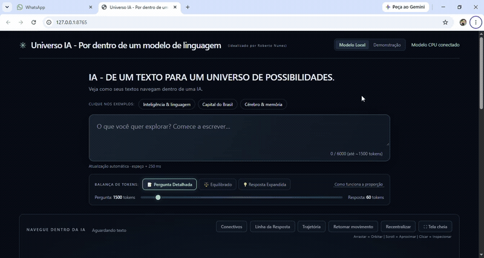
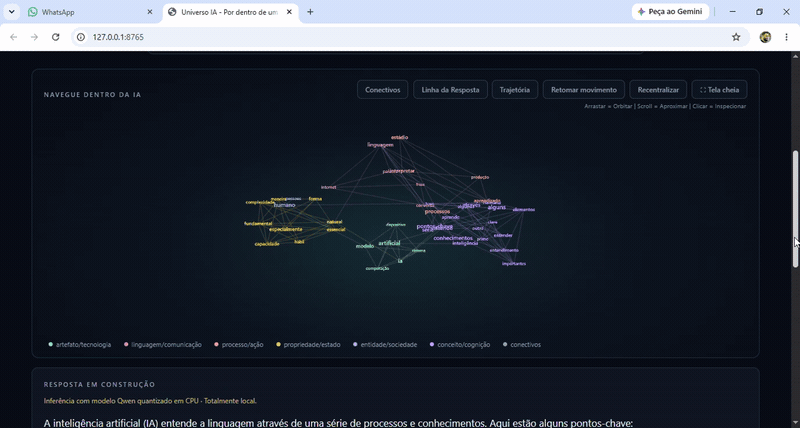
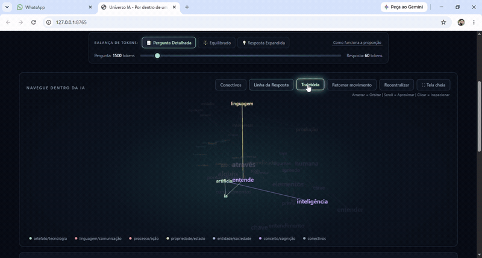

# Universo IA - Por dentro de um modelo de linguagem

[](https://www.python.org/)
[](https://fastapi.tiangolo.com/)
[](https://threejs.org/)
[](https://github.com/ggml-org/llama.cpp)
[](LICENSE)

Plataforma interativa de interpretabilidade e visualização em tempo real da mecânica interna de modelos de linguagem (LLMs). O projeto combina inferência local em CPU, projeção tridimensional lexical via Three.js e investigação probabilística de próximos tokens sem necessidade de placas de vídeo dedicadas ou APIs comerciais na nuvem.

Idealizado, concebido e validado por Roberto Nunes.  
Código e instrumentação técnica implementados via fluxos agênticos no Antigravity.

---

## Demonstração Visual



*Interação em tempo real: digitação com reanálise em 250 ms, projeção orbital 3D, inspeção lexical transparente, Modo Investigativo de próximos tokens e rastro neural em tela cheia.*

---

## O Que o Projeto Resolve

A mecânica interna de um Large Language Model é frequentemente tratada como uma "caixa preta" abstrata. O **Universo IA** foi concebido com a visão acadêmica e pedagógica de desmistificar esse funcionamento, permitindo a estudantes, pesquisadores e engenheiros:

1. **Visualizar a Seleção de Tokens e Probabilidades**: Compreender empiricamente como a amostragem escolhe a próxima palavra dentre um conjunto de candidatas e suas respectivas distribuições de probabilidade.
2. **Explorar a Topologia Semântica e Léxica**: Observar como as palavras de uma pergunta e de uma resposta se agrupam em famílias conceituais (tecnologia, mente, ciência, sociedade, conectivos estruturais) em um espaço vetorial tridimensional contínuo a 60 FPS.
3. **Equilibrar Latência e Contexto (Balança de Tokens)**: Estudar a relação de compromisso entre capacidade de contexto e custo computacional de decodificação sequencial em processadores comuns, prevenindo saturação de memória e latência excessiva.
4. **Auditar Concorrentes (Modo Investigativo)**: Clicar em qualquer ponto da resposta construída para inspecionar retrospectivamente quais alternativas foram cogitadas pela rede neural antes da decisão final.

---

## Principais Recursos

- **Inferência 100% Local em CPU**: Utiliza o modelo Qwen 2.5 0.5B Instruct quantizado em 4 bits (Q4_K_M) acoplado a um runtime C++ de alta eficiência (llama.cpp) consumindo menos de 600 MB de RAM.
- **Topologia Tridimensional em Three.js**: Renderização orbital a 60 quadros por segundo com rotação suave, suporte a zoom contínuo, isolamento por dimensão semântica e modo imersivo em tela cheia.
- **Balança Dinâmica de Tokens**: Sistema proporcional de ajuste fino que divide o orçamento de inferência entre pergunta e resposta através de presets otimizados (`Pergunta Detalhada`, `Equilibrado` e `Resposta Expandida`) ou slider contínuo.
- **Modo Investigativo Retrospectivo**: Divisão didática dos candidatos a próximos tokens entre classes estruturais (artigos, preposições e conectivos) e conceituais (verbos, substantivos e qualificadores), exibindo massa probabilística acumulada.
- **Rastro de Trajetória Neural (Cometa)**: Animação dinâmica que percorre a sequência cronológica da resposta na constelação 3D com destaque visual em pulso dourado.
- **Filtro de Conectivos Estruturais**: Alternância instantânea que permite ocultar ou evidenciar palavras funcionais de ligação sem fragmentar as conexões semânticas entre conceitos centrais.
- **Privacidade Absoluta e Custo Zero**: Nenhum dado trafega fora da sua máquina local. Sem telemetria oculta, sem cadastros, sem custos por token ou dependência de internet após a instalação inicial.

### Topologia Tridimensional e Trajetória Neural



*Navegação orbital a 60 FPS: agrupamento semântico dinâmico, realce da linha de pensamento em pulso dourado e condução do cometa de trajetória ao longo da resposta gerada.*

---

## Início Rápido (Quickstart)

A execução do Universo IA foi projetada para exigir o mínimo de atrito, permitindo iniciar o sistema completo em menos de 3 minutos.

### Pré-requisitos
- Sistema Operacional: Windows 10/11 x64 (Linux e macOS compatíveis via execução manual ou Docker).
- Python 3.11 ou superior instalado com o Python Launcher (`py`).
- 4 GB de memória RAM livre e processador com instruções AVX2 (qualquer processador x86_64 recente).

### Passo a Passo no Windows

1. **Clonar ou Baixar o Repositório** (~10 segundos):
   ```bash
   git clone https://github.com/seu-usuario/universo-local.git
   cd universo-local
   ```

2. **Instalação Automatizada** (~2 minutos, dependendo da sua conexão):
   Execute com duplo clique o arquivo `INSTALAR.bat` ou via terminal:
   ```cmd
   INSTALAR.bat
   ```
   *O instalador cria o ambiente virtual `.venv`, instala as dependências Python, baixa o runtime CPU otimizado do llama.cpp e obtém os pesos quantizados do Qwen 2.5 (aproximadamente 490 MB).*

3. **Iniciar a Aplicação** (~5 segundos):
   Execute com duplo clique o arquivo `INICIAR_APP.bat` ou via terminal:
   ```cmd
   INICIAR_APP.bat
   ```
   *O script iniciará o servidor backend e abrirá seu navegador padrão em `http://127.0.0.1:8765`.*

---

## Execução Manual e Outros Sistemas Operacionais

Para executar no Linux, macOS ou sem usar os arquivos de lote (`.bat`):

1. **Configurar o Ambiente Virtual**:
   ```bash
   python -m venv .venv
   source .venv/bin/activate  # No Windows: .venv\Scripts\activate
   pip install -r requirements.txt
   ```

2. **Preparar os Binários e o Modelo**:
   ```bash
   python preparar_modelo.py
   ```

3. **Iniciar o Servidor LLM (llama.cpp)**:
   ```bash
   # Execute em um terminal separado:
   ./runtime/llama-server -m models/qwen2.5-0.5b-instruct-q4_k_m.gguf --host 127.0.0.1 --port 8081 -ngl 0 -t 2 -c 2048 -np 1
   ```

4. **Iniciar o Servidor Web da Aplicação**:
   ```bash
   python server.py
   ```
   Acesse a interface em `http://127.0.0.1:8765`.

---

## Configuração e Variáveis de Ambiente

O comportamento do servidor pode ser customizado via arquivo `.env` na raiz do projeto ou por variáveis de ambiente do sistema:

```env
# Porta do servidor web FastAPI
PORT=8765

# Endereço e porta do servidor local do modelo LLM
MODEL_URL=http://127.0.0.1:8081

# Host de escuta
HOST=127.0.0.1

# Quantidade de threads de CPU alocadas para inferência
MODEL_THREADS=2

# Limite máximo de contexto total da janela (tokens)
MAX_CONTEXT_TOKENS=2048
```

---

## Arquitetura Técnica

O fluxo de dados do Universo IA opera em um ciclo contínuo e assíncrono entre a camada de renderização, o servidor web intermediário e o motor de inferência:

```
[ Navegador Web / Three.js ]
         │
         │  1. Entrada de texto + Proporção da Balança (HTTP POST /api/generate)
         ▼
[ Servidor FastAPI (server.py) ]
         │
         │  2. Tokenização, parsing lexical e validação de contexto
         ▼
[ Runtime llama.cpp (porta 8081) ]
         │
         │  3. Avaliação de logits, amostragem e cálculo de top-k
         ▼
[ Servidor FastAPI (server.py) ]
         │
         │  4. Enriquecimento semântico, cálculo de pesos e classificação
         ▼  (Server-Sent Events - SSE Streaming)
[ Interface do Usuário ]
    ├── Nuvem 3D: Atualização de nós, arestas e coordenadas espaciais
    ├── Resposta: Construção incremental com tokens interativos
    └── Modo Investigativo: Distribuição de probabilidades diretas e indiretas
```

---

## Balança de Tokens e Orçamento de Contexto

Diferente de interfaces de chat tradicionais, o Universo IA expõe diretamente a balança de recursos do modelo. A janela de contexto de 2.048 tokens é orçada para balancear tempo até o primeiro token (TTFT) e throughput de geração:

| Preset | Limite Pergunta | Limite Resposta | Cenário Recomendado | Latência Estimada |
| :--- | :---: | :---: | :--- | :---: |
| **Pergunta Detalhada** | ~1.500 tokens | 60 tokens | Perguntas longas, análise de parágrafos extensos | Menor tempo de resposta final |
| **Equilibrado** | ~900 tokens | 140 tokens | Perguntas cotidianas com respostas completas e explicativas | Equilíbrio ideal para CPU |
| **Resposta Expandida** | ~400 tokens | 260 tokens | Perguntas diretas que demandam geração detalhada e rica | Maior profundidade na nuvem 3D |

### Modo Investigativo e Auditoria de Probabilidades



*Inspeção retrospectiva de amostragem: clique em qualquer token da resposta para revelar a distribuição de probabilidade das alternativas diretas e indiretas computadas pelo modelo.*

---

## Requisitos de Hardware e Métricas Típicas

O benchmark de referência do projeto foi validado em hardware padrão de escritório:

- **Processador de Referência**: Intel Core i7-4500U (2 núcleos físicos / 4 threads, 1.80 GHz base).
- **Memória RAM**: 8 GB a 12 GB DDR3/DDR4.
- **Armazenamento**: 1.2 GB de espaço em disco (englobando modelo, runtime e arquivos do projeto).
- **Taxa de Geração (Throughput)**: 9 a 14 tokens por segundo em CPU.
- **Tempo até o Primeiro Token (TTFT)**: 150 ms a 450 ms para prompts de até 900 tokens.
- **Taxa de Quadros da Interface 3D**: 60 FPS estáveis com aceleração gráfica ativada no navegador.

---

## Execução em Contêiner Docker

Caso prefira isolar a execução em contêiner Linux:

```bash
# Construir a imagem Docker
docker build -t universo-ia .

# Executar o contêiner mapeando a porta da aplicação
docker run -d -p 8765:8765 --name universo-ia-app universo-ia
```

Consulte o arquivo `Dockerfile` incluído para obter detalhes sobre a composição da imagem base e parâmetros de execução.

---

## Roadmap e Contribuições

Contribuições, correções de bugs, melhorias de acessibilidade e novas abordagens didáticas para interpretabilidade de IA são calorosamente bem-vindas.

1. Faça um Fork do projeto.
2. Crie uma branch para sua funcionalidade: `git checkout -b feature/minha-melhoria`.
3. Valide os testes unitários da aplicação: `python -m unittest tests/test_protocol.py`.
4. Envie seus commits e abra um Pull Request detalhado.

Consulte o arquivo `CONTRIBUTING.md` para conhecer as diretrizes de código e estilo.

---

## Transparência Técnica e Engenharia Agêntica

Este projeto foi idealizado, desenhado arquiteturalmente, instruído e validado por Roberto Nunes.  
A implementação de código-fonte, suítes de teste e orquestração de componentes foram executadas através de fluxos de pair-programming agêntico no ecossistema Antigravity.

---

## Licença e Direitos Autorais

Idealização, arquitetura, design conceitual e código-fonte original:  
**Roberto Nunes** — Todos os direitos de propriedade intelectual reservados.

- **Uso Acadêmico e de Estudo**: Concedido livremente para fins de aprendizado pessoal, pesquisa acadêmica e demonstrações educacionais sem fins lucrativos, mediante preservação obrigatória dos créditos de autoria originais.
- **Uso Comercial e Derivados Proprietários**: Qualquer uso comercial, distribuição proprietária, sublicenciamento ou incorporação em produtos fechados depende de autorização prévia e expressa do autor.

Consulte o arquivo [LICENSE](LICENSE) para o texto jurídico integral.

### Atribuição de Componentes de Terceiros
- **Three.js**: Biblioteca de renderização 3D WebGL sob Licença MIT (Copyright © Ricardo Cabello).
- **llama.cpp**: Motor de inferência C++ sob Licença MIT (Copyright © Georgi Gerganov).
- **Qwen 2.5 0.5B Instruct**: Pesos do modelo distribuídos pela equipe Qwen sob Licença Apache 2.0.

---

⭐ Gostou do projeto? Deixe uma estrela no repositório para apoiar o desenvolvimento e a pesquisa independente!
